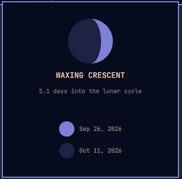

# Moon Phase

A theme-aware lunar phase and illumination widget for the Omarchy Quattro (Quickshell) bar. It computes the lunar cycle locally, no location, account, API key, or network request.



## Install

```sh
omarchy plugin add https://github.com/jeffmtb/omarchy-moon-phase.git --enable
```

The bar icon renders the continuously calculated illuminated portion of the lunar disk: the terminator is drawn as a projected ellipse, so crescents and gibbous phases are not limited to a fixed icon set.

Click the icon to see the phase name, approximate illumination, lunar age, cycle progress, and the next new and full moons in chronological order.

## Configure

Move the widget to another bar section with:

```sh
omarchy bar move jeffmtb.moon-phase --section right
```

## Accuracy boundary

Moon Phase uses the mean 29.53058867-day synodic cycle anchored to the known 2000-01-06 18:14 UTC new moon. It is a pleasant desktop approximation, not a full astronomical ephemeris and not suitable for navigation, tides, observation timing, or safety-critical use.

## Dependencies and permissions

Requires Omarchy Quattro and Qt/Quickshell runtime. It makes no network requests, launches no commands, requests no privileges, and writes no files.

## Remove

```sh
omarchy plugin remove jeffmtb.moon-phase
```


## Attribution

Moon Phase is based in part on
[Moon Arc](https://github.com/rookepoole/omarchy-moon-arc) by Rooke Poole, licensed under the MIT License.

## License

MIT © 2026 Jeffrey Lee.
